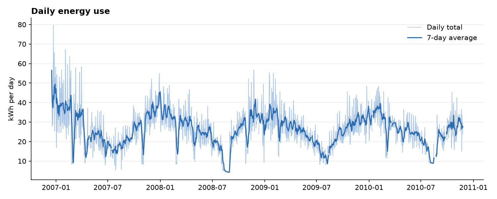
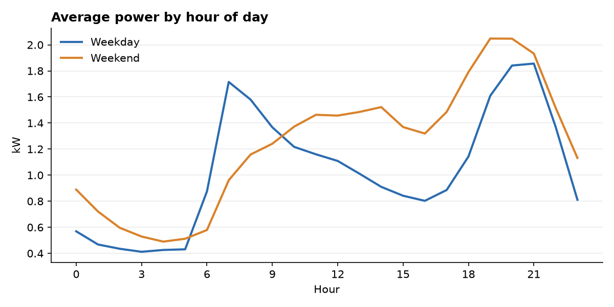
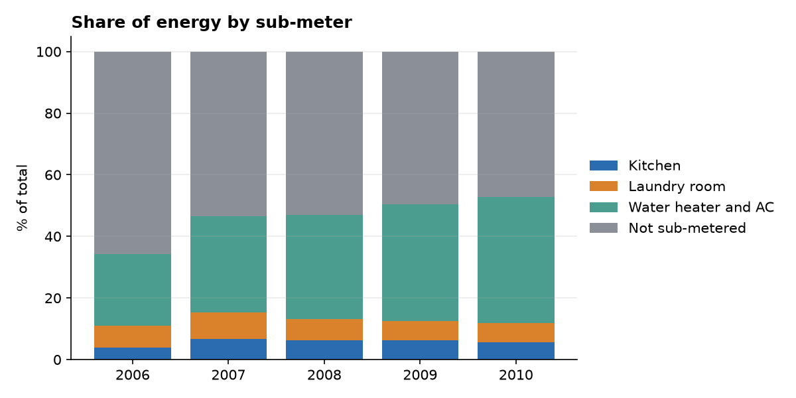

# Household power consumption


Four years of minute-by-minute electricity readings from one French household, cleaned with pandas, stored in SQLite and analysed with SQL. The data is the UCI [Individual household electric power consumption](https://www.kaggle.com/datasets/uciml/electric-power-consumption-data-set) dataset: 2,075,259 readings from December 2006 to November 2010.

## What the data shows

Everything below comes from the queries in [`queries/`](queries), run against `power.db`.

Winter use is more than double summer use. The household averaged 35.7 kWh a day in December and 13.7 in August, using only days with all 1,440 minutes recorded.



One stretch of August 2008 is flat. From 6 to 30 August 2008 the daily total sits between 4.2 and 6.2 kWh, then returns to 25.0 kWh on 31 August. A steady baseline like that fits an empty house with only always-on appliances, though the data cannot confirm it.

Weekdays have two peaks, weekends have one. On weekdays power peaks at 7:00 (1.7 kW) and again at 21:00 (1.9 kW). On weekends it stays higher through the day and peaks at 19:00 (2.0 kW).



The water heater and air conditioner take a growing share. Their meter accounted for 31.1% of energy in 2007 and 41.0% in 2010, while the part no sub-meter measures fell from 53.5% to 47.2%. The 2006 bar covers only 16 to 31 December.



## Data quality

Of the 2,075,259 rows, 25,979 (1.25%) have missing values, spread over 71 gaps. The longest runs 7,226 minutes, about five days in August 2010. There are no duplicate rows or timestamps.

Gaps of up to 60 minutes are filled by time-based interpolation: 288 minutes in total. The other nine gaps are longer, and they stay empty, leaving 25,691 rows (1.24%) as NULL in the database.

The first version used `Series.interpolate(limit=60)` to fill only short gaps. That does not work as intended: for a gap longer than the limit it fills the first 60 values and leaves the rest empty. That put 540 invented readings at the start of the nine long gaps. `fill_short_gaps` in [`data.py`](household_power/data.py) now fills a gap completely or not at all, and a test covers the case.

## SQL

Eight queries, each in its own file with comments explaining the approach. The tests run every one against a small database where the right answer is known, and the results on the full data were cross-checked against pandas.

| Query | Technique | Question |
|---|---|---|
| `01_daily_energy` | GROUP BY, date functions | How much energy per day? |
| `02_hourly_profile` | strftime, CASE | What does an average day look like? |
| `03_monthly_seasonality` | CTE, filtering complete days | Which months use the most? |
| `04_year_over_year` | self join, LEFT JOIN | Is a month up or down on the year before? |
| `05_rolling_7day` | window function with RANGE | What is the weekly trend? |
| `06_top_days_per_year` | RANK, PARTITION BY | Which were the heaviest days each year? |
| `07_submetering_share` | ratio of sums | Where does the energy go? |
| `08_missing_blocks` | gaps and islands with ROW_NUMBER | Where are the holes in the data? |

Timestamps are stored as `YYYY-MM-DD HH:MM:SS` text, which sorts in time order and is what SQLite's date functions read, and an index on that column turns a one-month lookup from a full scan of 2 million rows into an index search. The 7-day average uses `RANGE` over the date instead of `ROWS`, so a week with dropped days still covers seven calendar days.

## Run it

```bash
pip install -r requirements.txt
python -m household_power build      # clean the data and create power.db
python -m household_power report     # save the charts to figures/
python -m household_power query      # list the queries
python -m household_power query 08_missing_blocks
```

The first build downloads the dataset (about 130 MB) and takes around ten seconds. The database is built in a temporary file and renamed when complete, so an interrupted run never leaves a half-written `power.db`. Use `build --force` to rebuild an existing one.

## Layout

```
household_power/   data.py (load, check, clean), db.py (SQLite), report.py (charts)
queries/           the SQL
figures/           charts used above
tests/             pytest, runs offline on synthetic data
```

```bash
pip install -r requirements-dev.txt
pytest
```

## Limits

The data covers one household, so the findings describe that home and not households in general. The dataset ends in November 2010.
